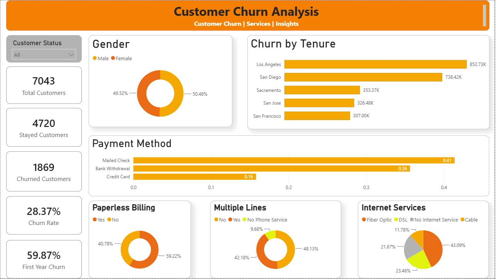

# Customer Churn Analysis Dashboard

## Project Overview
This project analyzes customer churn for a fictional telecom company using Python, SQL, and Power BI. The objective is to understand customer behavior, identify churn patterns, and discover factors associated with customer retention.

## Tools & Technologies
- Python – Data analysis and exploration
- SQL – Data querying and analysis
- Power BI – Interactive dashboard and visualization
- Excel/CSV – Dataset handling

## Dataset
- Source: Maven Analytics – Telecom Customer Churn
- Total Records: 7,043 customers
- Data includes customer demographics, services, contract details, payment methods, tenure, and customer status.

## Key Insights
- Overall churn rate: 28.38%
- First-year customer churn rate: 59.87%
- Month-to-month contract customers have a higher churn rate (51.69%).
- Fiber Optic customers show a higher churn rate (42.13%).
- Two-year contract customers have a lower churn rate (2.58%).

## Dashboard Preview

## Project Files
- Power BI Dashboard (.pbix)
- SQL Queries (.sql)
- Dataset (.csv)
- Dashboard Preview (.png)

## Author
**Kalpna Singh**

Aspiring Data Analyst | Python | SQL | Power BI | Excel

